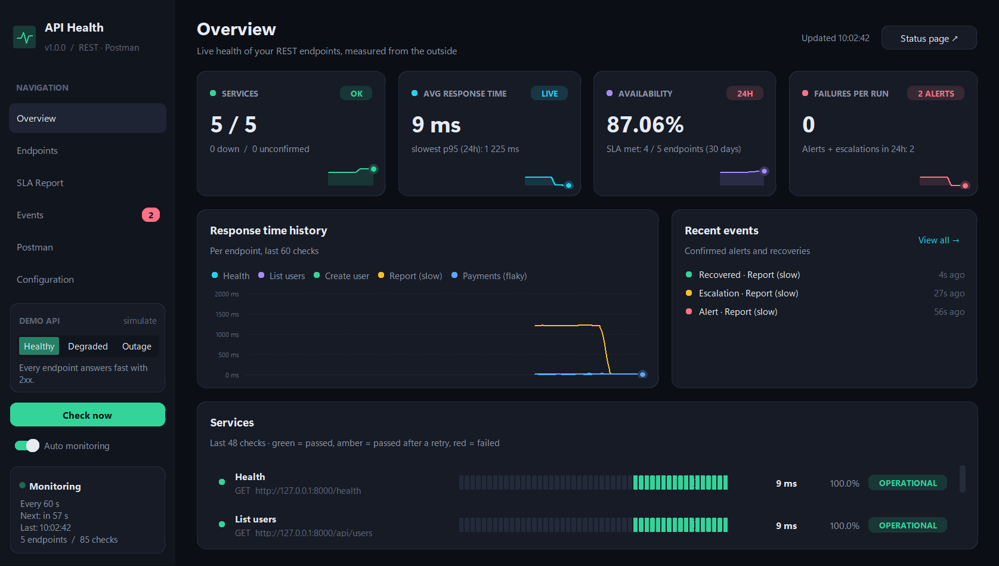
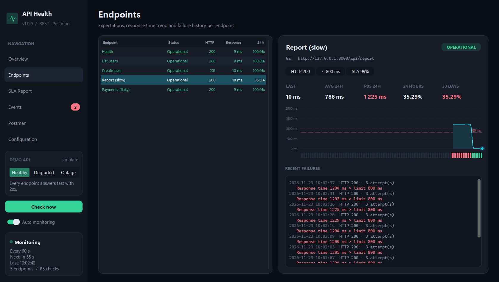
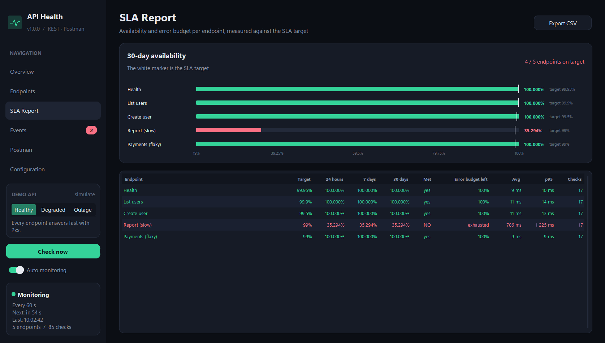
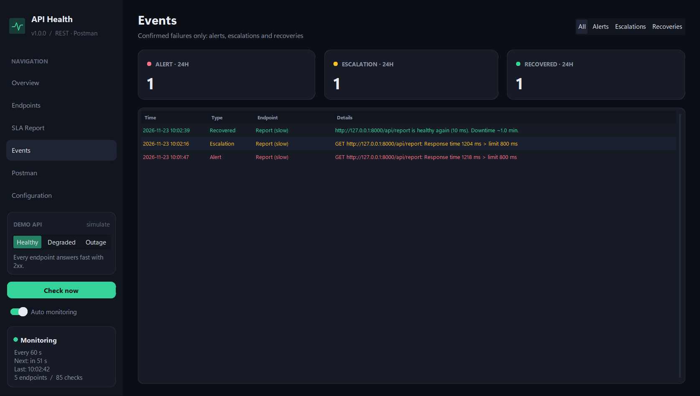
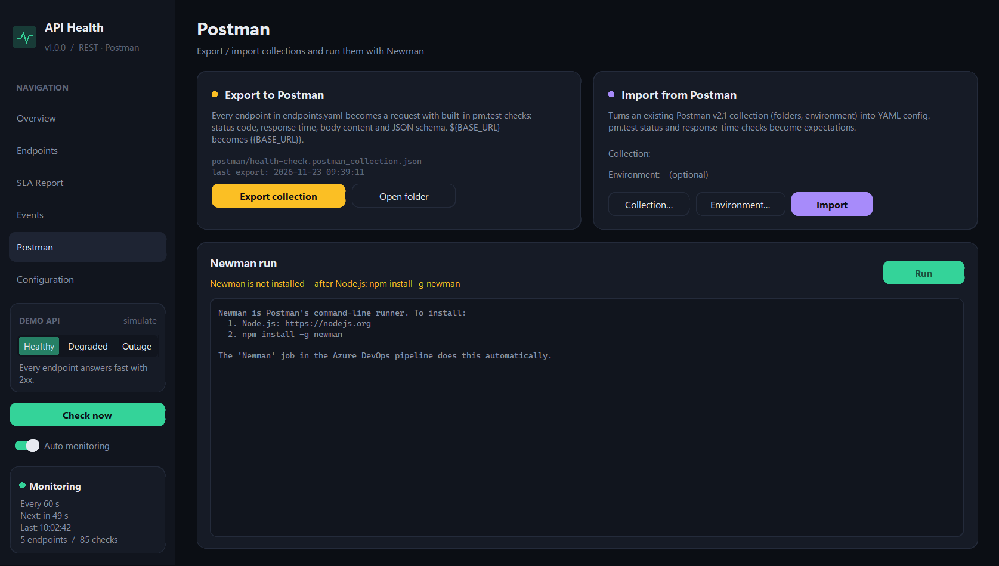
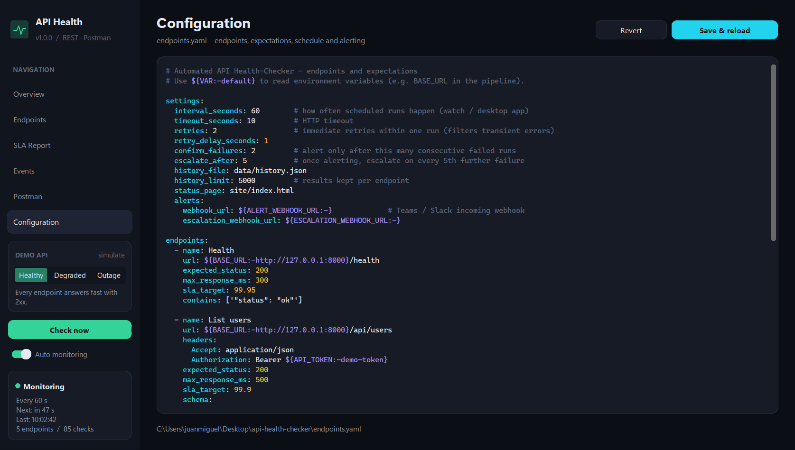
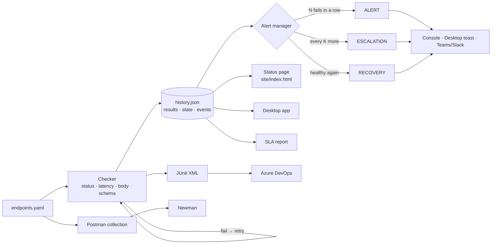

<div align="center">

# API Health-Checker

**A scheduled, outside-in health checker for REST APIs. It checks every endpoint's status code, response time, body content and JSON schema, measures availability against an SLA target, and alerts only on confirmed failures. It ships with a desktop dashboard, a static status page, two-way Postman integration and an Azure DevOps pipeline.**

[](https://www.python.org/)
[](#configuration)
[](#postman-and-newman)
[](#azure-devops)
[](https://github.com/TomSchimansky/CustomTkinter)

[](#)
[](#quick-start)
[](#command-line)
[](#configuration)
[](https://json-schema.org/)
[](#sla-and-error-budget)
[](#alerting-without-false-alarms)
[](#alerting-without-false-alarms)
[](#azure-devops)
[](#running-the-tests)

<br>



</div>

---

## Table of contents

- [Why](#why)
- [Features](#features)
- [Screenshots](#screenshots)
- [Quick start](#quick-start)
- [How it works](#how-it-works)
- [Configuration](#configuration)
- [Alerting without false alarms](#alerting-without-false-alarms)
- [SLA and error budget](#sla-and-error-budget)
- [Command line](#command-line)
- [Postman and Newman](#postman-and-newman)
- [Azure DevOps](#azure-devops)
- [Project structure](#project-structure)
- [Running the tests](#running-the-tests)
- [Troubleshooting](#troubleshooting)

---

## Why

Unit and integration tests tell you whether the code is correct. They can't tell you whether the **deployed** API is actually answering, fast enough, with the right data, *right now*.

API Health-Checker calls your endpoints from the outside, the way a client would. A single slow response or a 503 is retried before anything is reported, and an alert is only sent when the failure repeats. Every result is kept, so you can see how each endpoint is doing against its SLA over 24 hours, 7 days and 30 days.

## Features

| Area | What you get |
| --- | --- |
| **Declarative checks** | Endpoints and expectations live in one YAML file: method, headers, body, expected status codes, response-time limit, required text and a JSON Schema for the body. |
| **Fewer false alarms** | Each check is retried immediately to rule out a one-off error. An alert only fires after N failed runs in a row, keeps escalating while the failure lasts, and a recovery notice is sent with the length of the outage. |
| **SLA tracking** | Uptime per endpoint over 24 h, 7 days and 30 days, compared with its target, plus average / p95 response time and how much error budget is left. |
| **Desktop app** | A dark dashboard with KPI cards, response-time charts, per-service uptime bars, an event log, an SLA report with CSV export, and a YAML editor that validates before saving. Confirmed alerts pop up as toasts with a sound. |
| **Status page** | A static HTML/CSS page (no JavaScript) with the current state, the last 60 checks and a response-time sparkline for each service. It is rebuilt after every run. |
| **Postman** | Export the YAML to a Postman v2.1 collection with ready-made `pm.test` assertions, or import an existing collection (folders and environment included) into YAML. You can run it with Newman. |
| **CI/CD** | The Azure DevOps pipeline runs after every deploy and on a 15-minute schedule. It publishes JUnit results and the status page, and fails the build when an endpoint is down. |
| **Notifications** | Console, desktop toasts, and Teams / Slack incoming webhooks, with a separate webhook for escalations. |
| **Demo mode** | A built-in demo API you can switch between *Healthy*, *Degraded* and *Outage* from the sidebar. Use it to watch alerts, escalations and recoveries happen live. |

## Screenshots

<table>
  <tr>
    <td width="50%"><p align="center"><sub><b>Endpoints</b>: expectations, trend against the limit, recent failures</sub></p></td>
    <td width="50%"><p align="center"><sub><b>SLA Report</b>: 30-day uptime vs. target, error budget, CSV export</sub></p></td>
  </tr>
  <tr>
    <td width="50%"><p align="center"><sub><b>Events</b>: alerts, escalations and recoveries</sub></p></td>
    <td width="50%"><p align="center"><sub><b>Postman</b>: export, import and Newman runs</sub></p></td>
  </tr>
  <tr>
    <td colspan="2"><p align="center"><sub><b>Configuration</b>: highlighted YAML editor that validates before saving and keeps a backup</sub></p></td>
  </tr>
</table>

## Quick start

### Windows, one click

```bat
setup.bat         :: once: creates .venv and installs dependencies
start_gui.bat     :: desktop app + built-in demo API on port 8000
```

The app starts with the built-in demo API, so alerts, escalations and the SLA report have something to show right away. Use the **DEMO API** card in the sidebar to switch how the demo API behaves. Every switch runs a check immediately:

| Mode | Behaviour | What you'll see |
| --- | --- | --- |
| **Healthy** | every endpoint answers fast with 2xx | all green; open alerts turn into **RECOVERY** events |
| **Degraded** *(default)* | `/api/report` takes ~1.2 s, `/api/payments/status` returns 503 about 30 % of the time | an **ALERT** for the slow endpoint, amber "passed after retry" bars for the flaky one |
| **Outage** | every endpoint returns 503 | every service goes down; alerts, then escalations |

The demo API can also be run on its own (`python mock_api.py 8000 healthy`) and switched over HTTP:

```bash
curl -X POST http://127.0.0.1:8000/__demo/mode -H "Content-Type: application/json" -d "{\"mode\": \"outage\"}"
```

The DEMO API card only appears when a demo API is reachable on `127.0.0.1:8000`.

### Any platform, manually

```bash
python -m venv .venv
# Windows:      .venv\Scripts\activate
# Linux/macOS:  source .venv/bin/activate
pip install -r requirements.txt

python mock_api.py &              # optional demo API
python -m healthcheck run         # one run, prints a table, writes site/index.html
python -m healthcheck gui --demo  # desktop app
```

### Point it at your own API

1. Edit `endpoints.yaml`, or import a Postman collection: `python -m healthcheck postman-import my.postman_collection.json -o endpoints.yaml`
2. Set the base URL: `set BASE_URL=https://api.example.com` (PowerShell: `$env:BASE_URL="https://api.example.com"`)
3. Remove `--demo` from `start_gui.bat`.

## How it works



1. **Check:** all endpoints are called in parallel. A result fails if the status code isn't expected, the response is slower than the limit, a required string is missing, or the body doesn't match the schema.
2. **Retry:** a failed check is retried immediately (`retries`). A run only counts as failed if every attempt fails.
3. **Record:** each result goes into `data/history.json` along with the alert state. Old results are pruned per endpoint (`history_limit`).
4. **Alert:** the alert manager decides whether this failure is confirmed, should escalate, or ends an outage (see [below](#alerting-without-false-alarms)).
5. **Publish:** the status page is rebuilt, and in CI a JUnit report and an exit code are produced.

## Configuration

Everything lives in `endpoints.yaml`. Any value can read an environment variable with `${VAR}` or `${VAR:-default}`, so secrets and environment-specific URLs stay out of the file.

```yaml
settings:
  interval_seconds: 60
  retries: 2
  confirm_failures: 2
  escalate_after: 5
  alerts:
    webhook_url: ${ALERT_WEBHOOK_URL:-}

endpoints:
  - name: List users
    url: ${BASE_URL:-http://127.0.0.1:8000}/api/users
    headers:
      Authorization: Bearer ${API_TOKEN}
    expected_status: 200
    max_response_ms: 500
    sla_target: 99.9
    schema:
      type: array
      items:
        type: object
        required: [id, name, email]
```

### `settings`

| Key | Default | Meaning |
| --- | --- | --- |
| `interval_seconds` | `60` | Time between scheduled runs (`watch`, desktop app). |
| `timeout_seconds` | `10` | HTTP timeout per request. |
| `retries` | `2` | Immediate retries within one run before a check counts as failed. |
| `retry_delay_seconds` | `1` | Pause between retries. |
| `confirm_failures` | `2` | Consecutive failed runs needed before an `ALERT`. |
| `escalate_after` | `5` | While alerting, send an `ESCALATION` on every Nth further failure (`0` turns it off). |
| `history_file` | `data/history.json` | Where results and alert state are stored. |
| `history_limit` | `5000` | Results kept per endpoint. |
| `status_page` | `site/index.html` | Output path of the HTML status page. |
| `alerts.webhook_url` | – | Teams / Slack incoming webhook for alerts and recoveries. |
| `alerts.escalation_webhook_url` | – | Separate webhook for escalations (falls back to the main one). |

### `endpoints[]`

| Key | Default | Meaning |
| --- | --- | --- |
| `name` | *required* | Unique display name. |
| `url` | *required* | Full URL; environment variables allowed. |
| `method` | `GET` | Any HTTP method. |
| `headers` | `{}` | Request headers. |
| `body` | – | A dict/list is sent as JSON, a string as-is. |
| `expected_status` | `200` | One code or a list, e.g. `[200, 201]`. |
| `max_response_ms` | `1000` | Response-time limit. |
| `sla_target` | `99.9` | Availability target in percent. |
| `contains` | `[]` | Strings that must appear in the response body. |
| `schema` / `schema_file` | – | Inline JSON Schema, or a path to one (e.g. `schemas/user.json`). |
| `timeout_seconds` | inherited | Per-endpoint override of the HTTP timeout. |

## Alerting without false alarms

With the default `retries: 2`, `confirm_failures: 2` and `escalate_after: 5`:

| Run | Result | Consecutive failures | What happens |
| :-: | --- | :-: | --- |
| 1 | ✅ | 0 | – |
| 2 | ❌ after 3 attempts | 1 | nothing yet, shown as *Unconfirmed* |
| 3 | ❌ | 2 | **ALERT** (confirmed) |
| 4–6 | ❌ | 3–5 | – |
| 7 | ❌ | 6 | **ESCALATION #1** |
| 12 | ❌ | 11 | **ESCALATION #2** |
| 13 | ✅ | 0 | **RECOVERY**, with the outage duration |

A single 503 that recovers on retry never reaches the history as a failure. It shows up as an **amber** bar in the desktop app.

Webhook payload (works with Teams and Slack incoming webhooks):

```json
{ "text": "**[ALERT] Payments is DOWN (confirmed, 2 consecutive failures)**\n\nGET https://api.example.com/payments: Status 503, expected [200]" }
```

## SLA and error budget

Availability is the share of successful runs in a window (24 h, 7 days, 30 days). The **error budget** is how much downtime the SLA allows: a 99.9 % target allows 0.1 %. *Error budget left* shows how much of that allowance remains for the last 30 days. When it reaches zero, the SLA is breached.

```bash
python -m healthcheck report                 # table
python -m healthcheck report --json          # machine-readable
python -m healthcheck report --fail-on-breach   # exit code 2 if any SLA is missed
```

## Command line

```text
python -m healthcheck [-c endpoints.yaml] <command>

  run              one run of all checks       --junit out.xml  --fail-on-error  --no-alerts
  watch            check on a schedule         --interval 30
  report           SLA / availability report   --json  --fail-on-breach
  page             rebuild the status page     --open
  gui              desktop app                 --demo
  postman-import   Postman collection → YAML   -e environment.json  -o endpoints.yaml
  postman-export   YAML → Postman collection   -o postman/health-check.postman_collection.json
  newman           run a collection in Newman  --junit out.xml  --env-var BASE_URL=...
```

| Exit code | Meaning |
| :-: | --- |
| `0` | Success |
| `1` | At least one endpoint failed (`run --fail-on-error`) |
| `2` | At least one SLA is breached (`report --fail-on-breach`) |
| `3` | Invalid configuration |
| `4` | Runtime error (for example, Newman not installed) |

## Postman and Newman

**Export:** every endpoint becomes a request with tests such as:

```js
pm.test("Status code [200]", function () {
    pm.expect(pm.response.code).to.be.oneOf([200]);
});
pm.test("Response time < 500 ms", function () {
    pm.expect(pm.response.responseTime).to.be.below(500);
});
pm.test("JSON schema", function () {
    pm.response.to.have.jsonSchema(schema);
});
```

`${BASE_URL:-http://…}` becomes the collection variable `{{BASE_URL}}`, with the default as its value.

**Import:** requests, headers, JSON bodies, folders (`Folder / Request` names) and environment variables are read. Expectations are recovered from test scripts: `pm.response.to.have.status(…)`, `responseTime … below(…)`, `oneOf([…])`, response-text `include(…)` checks and inline schemas.

**Newman:** `npm install -g newman`, then `python -m healthcheck newman`, or use the **Postman** page in the desktop app.

## Azure DevOps

`azure-pipelines.yml` runs in two situations:

- **after every deploy** to `main`, so a broken release is caught before users notice;
- **every 15 minutes** on a schedule, even without new commits.

| Job | Steps |
| --- | --- |
| **Python health checker** | restore history from cache → `healthcheck run --junit --fail-on-error` → SLA report → publish JUnit results → publish `site/` as the `status-page` artifact |
| **Postman / Newman** | generate the collection from YAML → `newman run` with JUnit reporter → publish results |

Set these pipeline variables (secret where marked 🔒): `BASE_URL`, `API_TOKEN` 🔒, `ALERT_WEBHOOK_URL` 🔒, `ESCALATION_WEBHOOK_URL` 🔒.

## Project structure

```text
api-health-checker/
├── healthcheck/
│   ├── config.py        YAML loading, ${ENV} expansion, validation
│   ├── checker.py       HTTP checks, retries, JSON Schema validation
│   ├── history.py       result store, uptime and p95 statistics
│   ├── alerts.py        confirmation, escalation, recovery, webhooks
│   ├── runner.py        one full run + JUnit XML
│   ├── statuspage.py    static HTML/CSS status page
│   ├── postman.py       collection import / export, Newman runner
│   ├── cli.py           command line
│   └── ui/              desktop app (CustomTkinter)
│       ├── app.py       window, sidebar, toasts
│       ├── state.py     background monitor thread + snapshots
│       ├── widgets.py   charts, stat cards, tables
│       └── pages/       overview, endpoints, SLA, events, Postman, config
├── schemas/             JSON Schemas referenced by schema_file
├── tests/               pytest suite (runs against the demo API)
├── docs/screenshots/
├── endpoints.yaml       checks and settings
├── mock_api.py          demo REST API (healthy / degraded / outage modes)
└── azure-pipelines.yml
```

## Running the tests

```bash
pip install pytest
python -m pytest -q tests
```

The suite starts the demo API on a random port and covers schema violations, wrong status codes, slow responses, connection errors, POST bodies, the alert / escalation / recovery sequence, uptime math, the Postman export → import round trip, the demo API's healthy / outage modes, and a full run with the status page and JUnit output.

## Troubleshooting

| Symptom | Fix |
| --- | --- |
| Every request to `localhost` takes ~2 s on Windows | Windows tries IPv6 (`::1`) first. Use `127.0.0.1`, or make the server listen on IPv6 too. |
| *Newman is not installed* | Install Node.js, then run `npm install -g newman`. The pipeline's Newman job installs it automatically. |
| *Configuration error* on start | The message names the problem (missing `name`/`url`, duplicate name, missing schema file). The in-app editor won't save an invalid file. |
| Alerts never fire | Alerts need `confirm_failures` failed runs in a row. In CI, keep the `Cache@2` step so the history survives between runs. |
| Webhook alerts don't arrive | Check `ALERT_WEBHOOK_URL`. Delivery errors are logged; run with `-v` to see them. |
